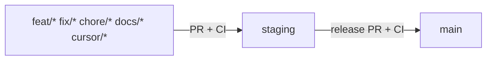

# Git workflow — feature → staging → main

Sam-Harness uses a three-lane flow. Both **`staging`** and **`main`** are protected; local hooks and the **`branch-flow`** CI check reinforce the same rules.

**Full guide:** [`CONTRIBUTING.md`](../CONTRIBUTING.md) · **Agents:** [`AGENTS.md`](../AGENTS.md)



## Lanes

| Branch | Role |
| --- | --- |
| `feat/*`, `fix/*`, `chore/*`, `docs/*`, `cursor/*`, … | Day-to-day work. Branch **from `staging`**. |
| `staging` | Integration / pre-release. All feature PRs land here first. |
| `main` | Production / release. Updated only via a release PR from `staging`. |

## Day-to-day

```bash
pnpm run git:new-branch -- feat/short-name
# ... work + conventional commits ...
pnpm run git:open-pr
```

1. Update from staging via the helper (or `git fetch origin staging`).
2. Open a **PR into `staging`** (not `main`).
3. **CI must pass**: `quality (ubuntu-latest)`, `quality (windows-latest)`, and **`branch-flow`**.
4. Merge into `staging` only after review + green CI.

## Release

1. Open a **release PR: `staging` → `main`**.
2. CI runs again (`quality` + `branch-flow`).
3. Merge into `main` only after review + green CI.
4. Tag / release notes as needed from `main`.

## CI triggers

- `.github/workflows/ci.yml` — push/PR to `main` or `staging` (job names `quality (…)`).
- `.github/workflows/branch-flow.yml` — PRs to `main` or `staging` (job name **`branch-flow`**).

## Protections (owner)

Configure GitHub branch protection on **`staging`** and **`main`**:

- Require a pull request before merging
- Require status checks: `quality (ubuntu-latest)`, `quality (windows-latest)`, and add **`branch-flow`**
- Require branches to be up to date; enforce for admins
- Disallow force pushes and deletions

Feature branches are not protected.
