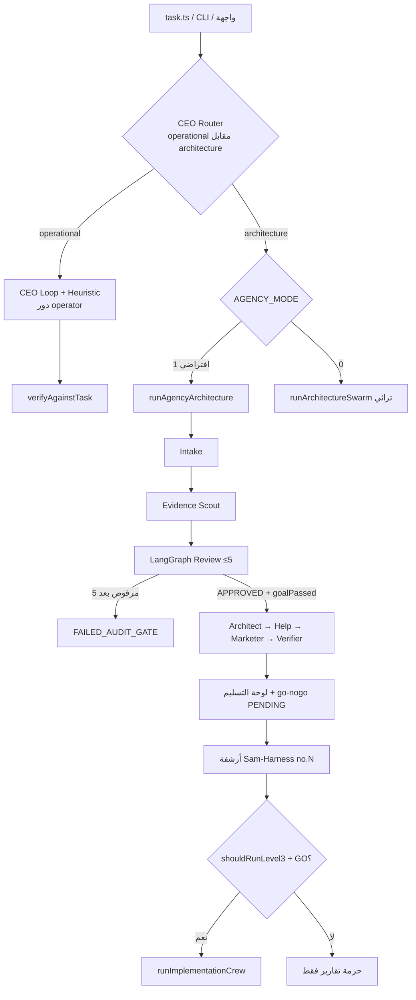
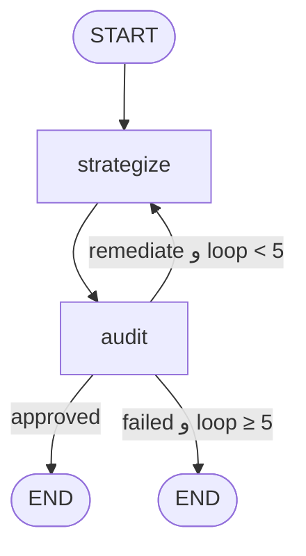
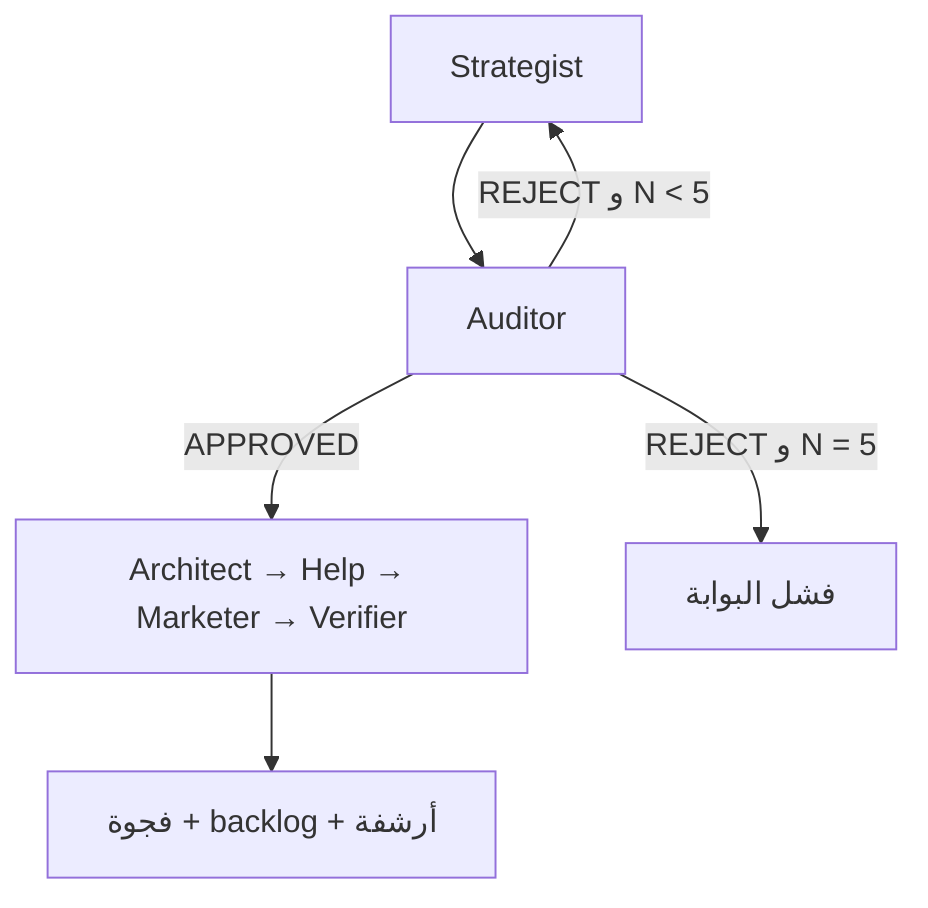
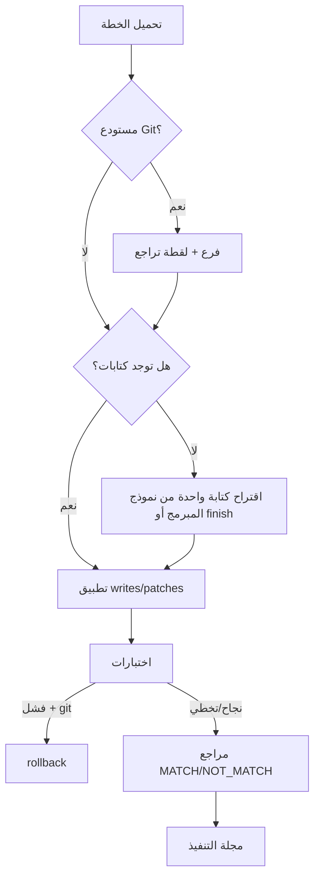
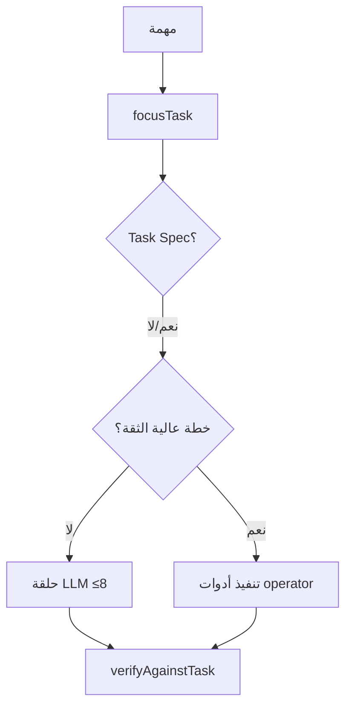

# خطة سير العمل والأدوار

المصدر: `src/agency/roles.ts`, `src/agency/runner.ts`, `src/agency/reviewGraph.ts`, `src/agent/level2Swarm.ts`, `src/agent/level3Implement.ts`, `src/agent/ceoLoop.ts`, `index.ts`.

## الأدوار (عقد الوكالة)

من `AGENCY_ROLES` — أحد عشر دوراً:

| المعرّف | العنوان | مخرجات معلنة |
| --- | --- | --- |
| `ceo_router` | CEO Router | تصنيف المسار وقرار البوابة |
| `intake` | Intake Analyst | `engagement.json` |
| `evidence` | Evidence Scout | `evidence-pack.md` |
| `strategist` | Strategist | `strategy-vN.md` |
| `auditor` | Security & Logic Auditor | `audit-vN.md`, `rejection-vN.md` |
| `architect` | Solution Architect | `execution-plan.md`, فجوة الكود/الخطة |
| `help` | Help Systems | `help-system-spec.md` داخل حزمة التقارير |
| `marketer` | GTM Marketer | `marketing-campaign.md` |
| `verifier` | CEO Verifier | `final-report.md` |
| `implementer` | Implementer | `EXECUTION_JOURNAL.md` (بعد GO فقط) |
| `operator` | Desktop Operator | نتائج أدوات سطح المكتب (مسار تشغيلي L1) |

> **المرحلة 8:** `prefersCloud` وخريطة `roles` في ملف الهجين تُستشار في التوجيه الحي (سقف التكلفة يفوز دائماً). نماذج الأدوار وترتيب خطوات ما بعد الموافقة من `config/team.json`. مصفوفة الأدوات في `ROLE_CAPABILITIES` / `OPERATOR_CAPABILITIES`.

دور `help` في الوكالة يكتب مواصفة مساعدة داخل الحزمة بعد موافقة المدقق — هذا **غير** نفس نظام المساعدة داخل المنتج (`docs/help` + CLI/API/UI) الذي تقرأه الآن.

## خريطة المسارات من CLI

- المسار الافتراضي للتحليل: `AGENCY_MODE=1` (LangGraph).
- `--implement-only` يتخطى L1/L2 ويذهب لـ Level-3 بعد تفويض GO.
- قيم المسار `intake` / `review_only` موجودة في الأنواع فقط — **CLI لا يختارها مباشرة** (**مخطط / غير منفّذ كمسارات CLI**).

## حلقة المراجعة (LangGraph)

`MAX_LOOPS = 5` في `reviewGraph.ts`.

- بعد موافقة نموذج المدقق تُطبَّق بوابة صلبة `scoreGoalFidelity` — يمكن قلب الموافقة إلى رفض إن فشلت مطابقة الهدف.
- يُنشأ checkpointer للتشغيلات القابلة للاستئناف.

## السرب Level-2 (تراثي)

عند `AGENCY_MODE=0`: حلقة خطية Strategist↔Auditor حتى 5 مرات، ثم Architect/Help/Marketer إن وُوفق.  
**بدون** بوابة goal-fidelity و**بدون** لوحة تسليم من هذا المسار. بعض المطالبات ما زالت مرتبطة بسياق Maw3ed/حجز (**ميراث**).

## Level-3 تنفيذ

يتطلب تفويضاً: `--go` أو `IMPLEMENT_GO=1` أو `go-nogo.json` بقرار `GO`.  
الخطة من `level3-plan.json` (أو أسماء بديلة). يرفض الكتابة إن القرار ≠ GO.

## مسار تشغيلي L1 (سطح المكتب)

`runOperationalCeoLoop` حتى ٨ خطوات: Task Spec أو heuristic → أدوات عبر `executeToolAsRole("operator", …)` أو حلقة LLM محلية.

