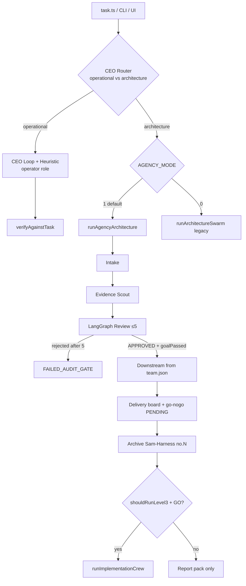
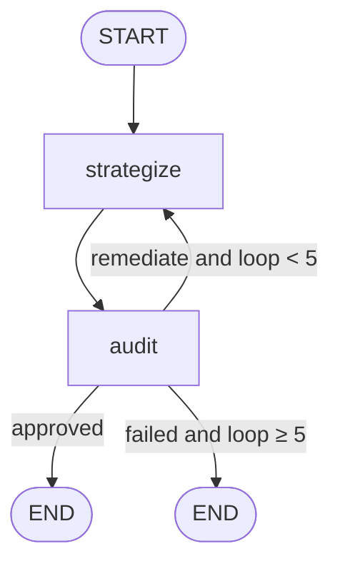
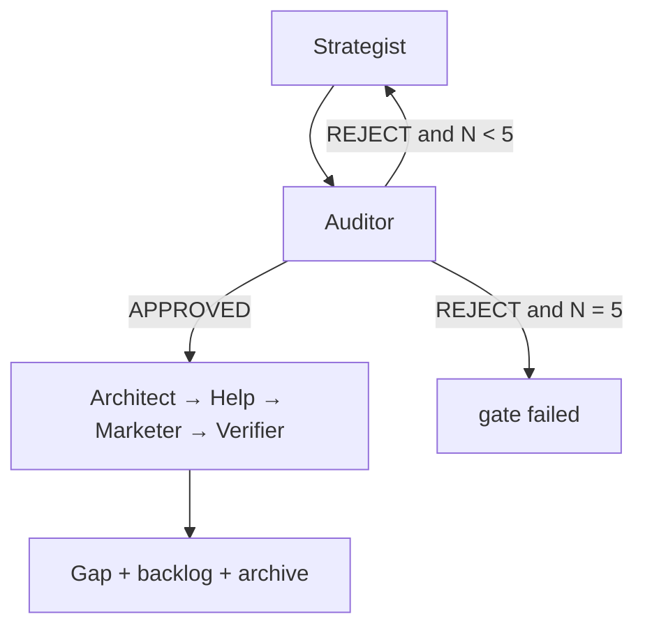
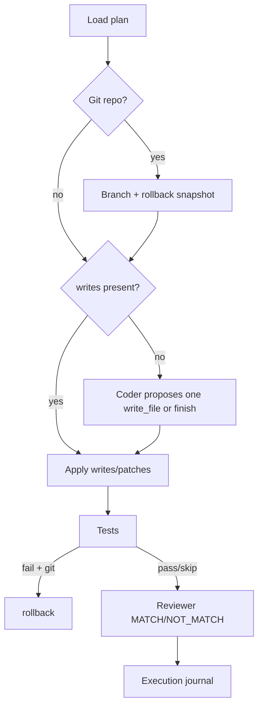
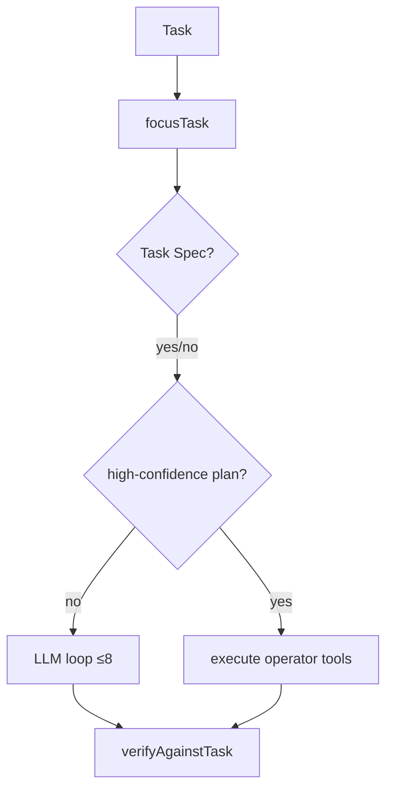

# Workflow plan & roles

Sources: `src/agency/roles.ts`, `runner.ts`, `reviewGraph.ts`, `src/agent/level2Swarm.ts`, `level3Implement.ts`, `ceoLoop.ts`, `index.ts`.

## Roles (agency contracts)

From `AGENCY_ROLES` — eleven roles:

| Id | Title | Declared outputs |
| --- | --- | --- |
| `ceo_router` | CEO Router | route / gate decision |
| `intake` | Intake Analyst | `engagement.json` |
| `evidence` | Evidence Scout | `evidence-pack.md` |
| `strategist` | Strategist | `strategy-vN.md` |
| `auditor` | Security & Logic Auditor | `audit-vN.md`, `rejection-vN.md` |
| `architect` | Solution Architect | `execution-plan.md`, gap matrix |
| `help` | Help Systems | `help-system-spec.md` inside the report pack |
| `marketer` | GTM Marketer | `marketing-campaign.md` |
| `verifier` | CEO Verifier | `final-report.md` |
| `implementer` | Implementer | `EXECUTION_JOURNAL.md` (after GO only) |
| `operator` | Desktop Operator | desktop tool results (L1 operational path) |

> **Phase 8:** `prefersCloud` and the hybrid profile `roles` map are consulted by live routing (cost cap still wins). Per-role models and downstream step order come from `config/team.json`. Real tool ACL lives in `ROLE_CAPABILITIES` / `OPERATOR_CAPABILITIES` (custom roles may declare tools).
>
> **Phase 9:** Control Plane **Workflow graph** tab draws the same spine and writes `team.json`, with positions in `workflow-layout.json`. Review loop and GO gate stay locked. See `docs/PHASE9_VISUAL_EDITOR.md`.

The agency `help` role writes a help **spec artifact** after auditor approval — that is **not** the same as this in-product Help system (`docs/help` + CLI/API/UI).

## CLI route map

- Default analysis runtime: `AGENCY_MODE=1` (LangGraph).
- `--implement-only` skips L1/L2 and goes to Level-3 after GO.
- Route values `intake` / `review_only` exist in types only — **not selectable as CLI routes** (**planned / not yet implemented** as CLI routes).

## Review loop (LangGraph)

`MAX_LOOPS = 5` in `reviewGraph.ts`.

- After LLM auditor approve, a hard `scoreGoalFidelity` gate can flip APPROVED → REJECTED.
- Checkpointer enables resumable runs.

## Level-2 swarm (legacy)

With `AGENCY_MODE=0`: linear Strategist↔Auditor up to 5 times, then Architect/Help/Marketer if approved.  
**No** goal-fidelity gate and **no** delivery board from this path. Some prompts remain Maw3ed/booking-flavoured (**legacy**).

## Level-3 implement

Requires authorization: `--go` or `IMPLEMENT_GO=1` or `go-nogo.json` with `GO`.  
Plan from `level3-plan.json` (or alternate names). Refuses writes when decision ≠ GO.

## L1 operational (desktop)

`runOperationalCeoLoop` up to 8 steps: Task Spec or heuristic → tools via `executeToolAsRole("operator", …)` or local LLM loop.

